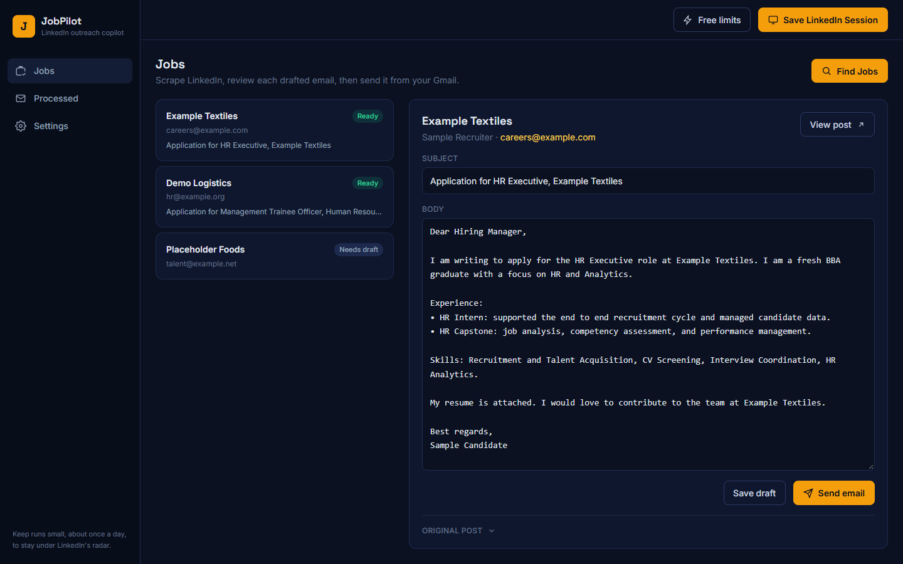
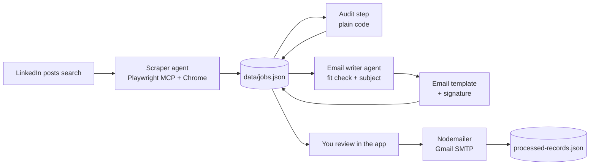
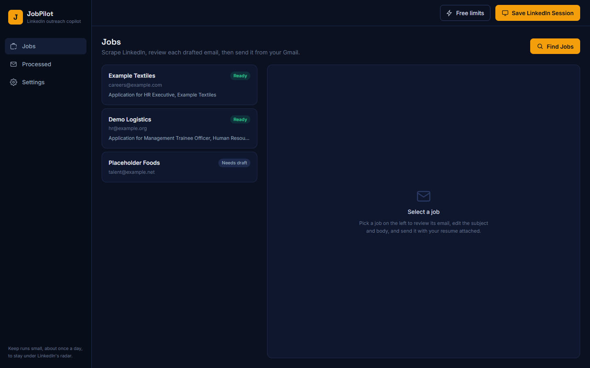
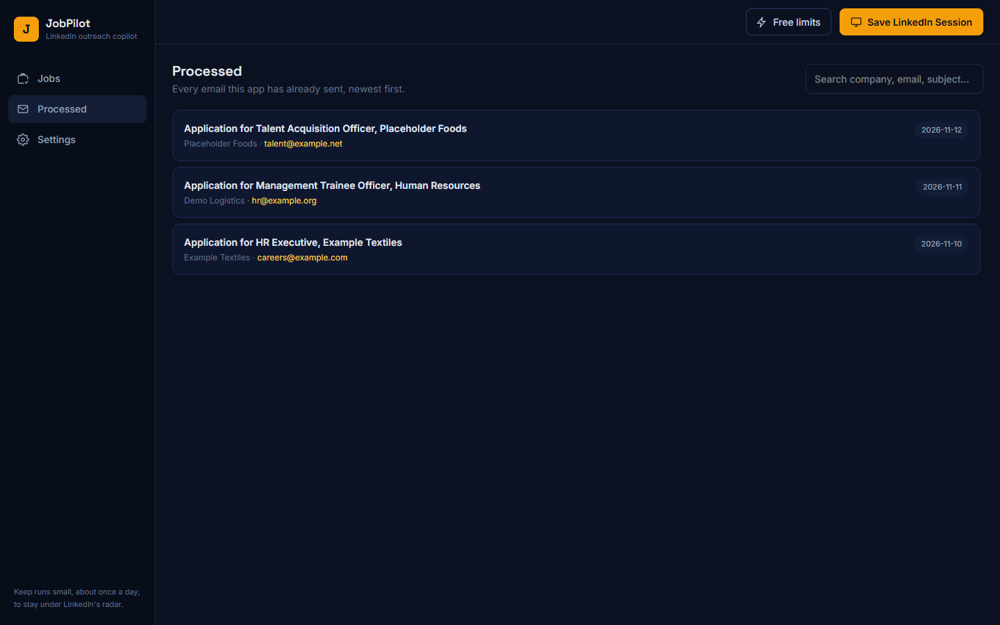
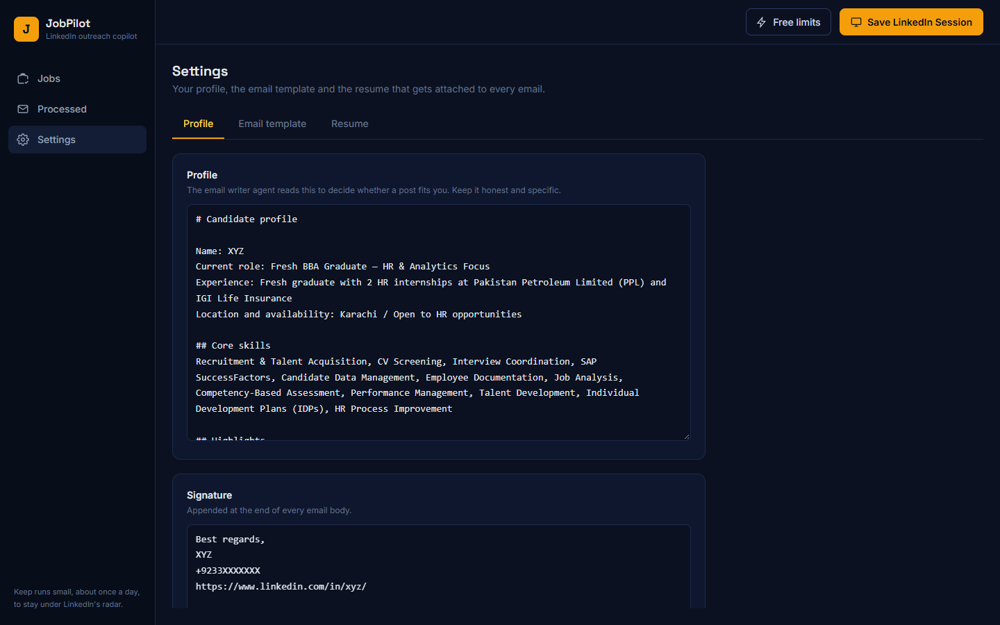

<div align="center">

# JobPilot

**Finds LinkedIn hiring posts, drafts a personal email for each one, and sends it with your resume attached.**




</div>

## Table of Contents

- [About](#about)
- [Features](#features)
- [How It Works](#how-it-works)
- [Screenshots](#screenshots)
- [Tech Stack](#tech-stack)
- [Project Structure](#project-structure)
- [Getting Started](#getting-started)
- [Environment Variables](#environment-variables)
- [Using the Web App](#using-the-web-app)
- [Using the CLI Pipeline](#using-the-cli-pipeline)
- [Where Your Data Lives](#where-your-data-lives)
- [API Reference](#api-reference)
- [Logs and Troubleshooting](#logs-and-troubleshooting)
- [Before You Run It](#before-you-run-it)

## About

Job hunting on LinkedIn means scrolling through hiring posts, copying recruiter emails out of the text, and writing the same application email over and over. JobPilot does that loop for you.

Two AI agents do the thinking. The first one drives a real Chrome browser, reads the LinkedIn posts search for your query, and saves each hiring post it finds along with the recruiter's email address. The second one reads each saved post, decides whether the role actually fits your profile, and pulls out the details needed to fill your email template. You review every draft in a web app before anything is sent, and each email goes out from your own Gmail with your resume attached.

It runs entirely on your machine. Nothing is uploaded anywhere except the model calls to OpenRouter and the emails you choose to send.

## Features

- 🔎 **Agentic scraping** — a Claude agent browses LinkedIn through Playwright MCP, scrolls the posts search, and saves hiring posts in a structured format (author, company, recruiter email, post text, post link).
- 🧹 **Automatic auditing** — duplicates and recruiters you already emailed are dropped; posts with no readable email are parked in a separate file instead of silently lost.
- ✍️ **Fit check and drafting** — a second agent decides whether each post matches your profile. Misfits are skipped and never emailed; matches get a subject line and a body built from your own template.
- 📬 **Review before sending** — every draft is editable in the app. Nothing leaves your Gmail until you click Send.
- 📎 **Resume attached automatically** — your PDF goes out with every email.
- 📁 **Sent history** — a searchable record of every email already sent, so the same recruiter is never contacted twice.
- ⚙️ **Everything editable in the UI** — profile, signature, email template and resume, all from the Settings page.
- ⚡ **Free-tier aware** — a built-in check shows how many free OpenRouter requests your key has left today.

## How It Works

In plain words, the full journey:

1. **You sign in to LinkedIn once.** The app opens a Chrome window using your `li_at` cookie and keeps that browser profile on disk, so later runs are already signed in.
2. **You click Find Jobs.** The scraper agent opens the LinkedIn posts search for your query (sorted by top match, limited to the past week), scrolls through up to 30 posts, and saves every hiring post that mentions words like "resume", "apply" or "hiring". Internship posts are skipped.
3. **The audit step cleans the list.** Posts from recruiters you already emailed are removed, and posts with no email address are moved to a "missing" file for you to look at by hand.
4. **The email writer agent reads each post.** It judges whether the role fits the profile you wrote. If it does not fit, the post is moved to a skipped file and is never emailed. If it does, the agent produces a subject line and the placeholders your template needs.
5. **You review each draft.** Open a job in the app, edit the subject and body if you want, and click Send. The email goes out through your Gmail with your resume attached.
6. **The record moves to Processed.** That recruiter will not come up again in a future run.



Every stage reads and writes the same `data/jobs.json` file, so you can stop after any stage and pick up later.

## Screenshots

<table>
  <tr>
    <td width="50%"><p align="center"><b>Jobs</b> — every refined post, with draft status</p></td>
    <td width="50%"><p align="center"><b>Review</b> — edit the subject and body, then send</p></td>
  </tr>
  <tr>
    <td width="50%"><p align="center"><b>Processed</b> — searchable history of sent emails</p></td>
    <td width="50%"><p align="center"><b>Settings</b> — profile, template and resume</p></td>
  </tr>
</table>

<sub>Screenshots use placeholder companies and `example.com` addresses, not real recruiter data.</sub>

## Tech Stack

| Layer | Technology |
|---|---|
| Agents | [Claude Agent SDK](https://github.com/anthropics/claude-agent-sdk-typescript) with structured JSON output |
| Model provider | OpenRouter (free models by default), pointed at via the SDK's Anthropic-compatible base URL |
| Browser automation | [Playwright MCP](https://github.com/microsoft/playwright-mcp) driving your installed Chrome |
| Backend | Hono on Node, served by `@hono/node-server` |
| Frontend | Angular 20 (standalone components, signals) + Tailwind CSS 4 |
| Email | Nodemailer over Gmail SMTP (port 465, TLS) |
| Storage | Plain JSON files under `data/` — no database |
| Runtime | TypeScript run directly with `tsx` |
| Validation | Zod for the agent tool schema |

## Project Structure

```text
src/
├── index.ts              # CLI entry point and stage router
├── agent-sdk.ts          # Claude Agent SDK wrapper: model config, tool gate, rate-limit handling
├── prompts.ts            # System prompts for both agents
├── constants.ts          # Every path, limit, pattern and schema in one place
├── interfaces.ts         # Shared types
├── agents/               # scraper-agent.ts, email-writer-agent.ts
├── steps/                # save-linkedin-session.ts, audit-records.ts, send-emails.ts
├── tools/                # save-post-tool.ts — the MCP tool the scraper agent calls
├── server/               # Hono API + run-manager.ts (tracks the active run and its logs)
└── utils/                # json-store, email-utils, env-utils, logger, date-utils

client/                   # Angular app
└── src/app/
    ├── core/             # api.service, run.service (polls run state), toast.service, models
    └── pages/            # jobs, processed, settings

data/                     # JSON state, profile, resume, saved browser profile
logs/                     # agent.log and tool-calls.jsonl
```

## Getting Started

### Prerequisites

- [Node.js 20+](https://nodejs.org/) and npm
- **Google Chrome** installed — the scraper drives your real Chrome, not a bundled browser
- An [OpenRouter API key](https://openrouter.ai/keys) (the default model is free)
- A Gmail account with 2-Step Verification and an [App Password](https://myaccount.google.com/apppasswords)
- A LinkedIn account

### Installation

```bash
git clone https://github.com/shahzaibtahameedev/jobpilot-agent.git
cd jobpilot-agent
npm install
npm install --prefix client
```

### Configuration

```bash
cp .env.example .env
```

Fill in `.env` using the table below, then start the app:

```bash
npm run app
```

Open <http://localhost:3000>.

On first start the app creates the folders it needs under `data/`, so there is nothing else to set up. Before your first run, open **Settings** and fill in your profile, signature, email template and resume — the email writer agent refuses to run while `data/profile/profile.md` still has placeholder text.

### Development servers

| Command | What it does |
|---|---|
| `npm run app` | Builds the Angular client and serves the whole app at <http://localhost:3000> |
| `npm run dev:server` | API server only, with reload on change (port 3000) |
| `npm run dev:client` | Angular dev server on port 4200, proxying `/api` to port 3000 |
| `npm run typecheck` | Type-checks the backend with `tsc --noEmit` |

For day-to-day frontend work, run `npm run dev:server` and `npm run dev:client` in two terminals and use port 4200.

## Environment Variables

| Variable | Required | Description | Example |
|---|---|---|---|
| `OPENROUTER_API_KEY` | ✅ | Your OpenRouter key. Both agents and the free-limits check use it. | `sk-or-v1-...` |
| `GMAIL_USER` | ✅ to send | The Gmail address the emails are sent from. | `you@gmail.com` |
| `GMAIL_APP_PASSWORD` | ✅ to send | A Gmail App Password, not your normal password. Spaces are stripped automatically. | `abcd efgh ijkl mnop` |
| `LINKEDIN_LI_AT` | Recommended | Your LinkedIn `li_at` session cookie. Without it you simply sign in by hand in the Chrome window. | `AQEDAT...` |
| `MODEL` | Optional | OpenRouter model slug. Defaults to `google/gemma-4-31b-it:free`. | `google/gemma-4-31b-it:free` |
| `SEARCH_QUERY` | Optional | The LinkedIn posts search. Keep the outer single quotes so the inner double quotes survive. Defaults to an HR query. | `'"HR" AND "Karachi"'` |
| `SENDER_NAME` | Optional | Display name on outgoing emails. Without it, only the address is shown. | `Your Name` |
| `TEST_RECIPIENT` | Optional | Send every email to this address instead of the recruiter, with `[TEST to ...]` prefixed to the subject. Test sends are **not** marked as processed. | `you@gmail.com` |
| `PORT` | Optional | Server port. Defaults to `3000`. | `3000` |

> **Note:** `.env.example` ships with `MODEL=openrouter/free`, which is a placeholder rather than a real slug. Either set a real OpenRouter model slug or remove the line to fall back to the default.

### Getting your `li_at` cookie

Sign in to LinkedIn in Chrome, open DevTools → Application → Cookies → `https://www.linkedin.com`, and copy the value of `li_at`. It is a session token: treat it like a password and never commit it.

## Using the Web App

**Save LinkedIn Session** (top right) opens Chrome with your cookie applied. The window closes on its own once your feed loads, and the signed-in browser profile is kept in `data/browser-profile`. Do this once, and again whenever the session expires.

**Jobs** is the main page. Click **Find Jobs** to run scrape → audit → drafting, with the current stage and live log shown as it goes. When it finishes, every refined post is listed on the left. Click one to see the recruiter, the original post and the drafted email; edit the subject or body, then **Save draft** or **Send email**. Posts the writer could not draft yet are tagged *Needs draft*.

**Processed** lists every email already sent, newest first, searchable by company, recruiter, address or subject.

**Settings** has three tabs: *Profile* (the candidate profile the fit check reads, plus your signature), *Email template* (the placeholders `{{positionName}}`, `{{companyName}}` and `{{recruiterName}}` are required and the server rejects a template missing any of them) and *Resume* (upload a PDF, up to 10 MB).

**Free limits** shows the daily free-model request limit, usage and remainder for your OpenRouter key.

When a placeholder cannot be filled, it falls back to "open HR", "your organization" and "Hiring Manager".

## Using the CLI Pipeline

The original pipeline still works and shares all the same files, so you can mix it with the app freely.

| Command | What it does |
|---|---|
| `npm start` | Runs every stage in order: scrape → audit → write → send |
| `npm run login` | Opens LinkedIn so you can sign in again |
| `npm run scrape` | Scraper agent only: search, scroll, save posts |
| `npm run audit` | Drops duplicates; moves posts with no email to `data/ambiguity/missing.json` |
| `npm run write-emails` | Fit check and drafting; misfits go to `data/processed/skipped.json` |
| `npm run send` | Sends every drafted email, 10 seconds apart, then moves each one to the processed file |

Set `TEST_RECIPIENT` in `.env` first to send everything to yourself as a dry run.

The CLI's `send` stage mails every ready draft without asking. If you want to approve each one, use the web app instead.

## Where Your Data Lives

| Path | What's in it |
|---|---|
| `data/jobs.json` | The working set: posts found, audited and drafted but not yet sent |
| `data/processed/processed-records.json` | Every email actually sent, with the date |
| `data/processed/skipped.json` | Posts the writer judged a poor fit; never emailed |
| `data/ambiguity/missing.json` | Posts with no readable recruiter email, for manual review |
| `data/profile/profile.md` | The candidate profile the fit check reads |
| `data/profile/email-template.txt` | The email body template with its three placeholders |
| `data/profile/signature.txt` | Appended to the end of every body |
| `data/resume/resume.pdf` | Attached to every email |
| `data/browser-profile/` | The signed-in Chrome profile (git-ignored) |

Legacy date-wise files in `data/raw/` are merged into `data/jobs.json` automatically on first run.

## API Reference

All routes are served under `/api` by the Hono server on port 3000.

| Method | Route | Purpose |
|---|---|---|
| `GET` | `/api/jobs` | The current working set of jobs |
| `PUT` | `/api/jobs/:id` | Save an edited subject and body |
| `POST` | `/api/jobs/:id/send` | Send one job's email, with optional overrides |
| `GET` | `/api/processed` | Sent history, newest first |
| `GET` | `/api/runs/current` | Status, stage, logs and error of the active run |
| `POST` | `/api/runs/find-jobs` | Start scrape → audit → draft |
| `POST` | `/api/runs/session` | Open the LinkedIn sign-in window |
| `GET` / `PUT` | `/api/template` | Read or replace the email template |
| `GET` / `PUT` | `/api/profile` | Read or replace the profile and signature |
| `GET` / `POST` | `/api/resume` | Resume metadata, or upload a new PDF |
| `GET` | `/api/resume/file` | Download the current resume |
| `GET` | `/api/limits` | OpenRouter free-tier counters for your key |

Only one run can be active at a time; starting a second returns `409`.

## Logs and Troubleshooting

- `logs/agent.log` — everything the pipeline printed
- `logs/tool-calls.jsonl` — one line per tool call the agents made, with inputs and results

| Problem | What's happening |
|---|---|
| "No LinkedIn session found" | Click **Save LinkedIn Session** first; the run needs `data/browser-profile` to exist. |
| The run stops with a rate-limit message | The model provider returned HTTP 429. The pipeline aborts immediately rather than burning more calls. Posts and drafts saved so far are kept — run it again later. |
| "profile.md still has placeholder text" | Fill in your profile on the Settings page before drafting. |
| The scraper finds nothing | Your session may have expired, or LinkedIn showed a checkpoint. Re-save the session and try a broader `SEARCH_QUERY`. |
| Gmail refuses the message | Check that `GMAIL_APP_PASSWORD` is an App Password and that 2-Step Verification is on. |

The agents run on a tight leash: the scraper can only use Playwright tools plus `save_post`, and screenshots, file uploads, cookie edits and `browser_close` are blocked outright. It is instructed never to like, comment, repost, message, follow or connect with anyone.

## Before You Run It

Automating LinkedIn is against its User Agreement, and an account doing it can be restricted. This project is a personal tool, not a growth service — keep runs small (the scraper is capped at 30 posts) and roughly once a day.

You are also emailing real people. Review every draft, keep the volume sane, and don't send anything you wouldn't be happy to receive.
